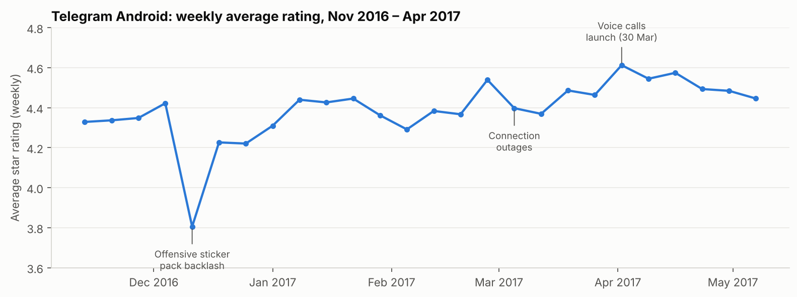
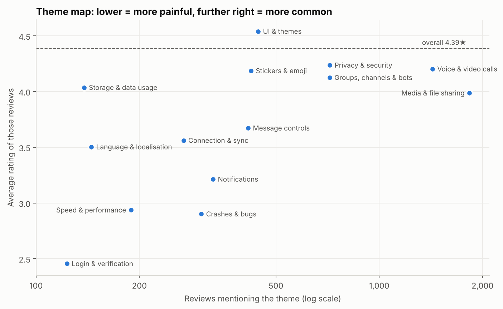
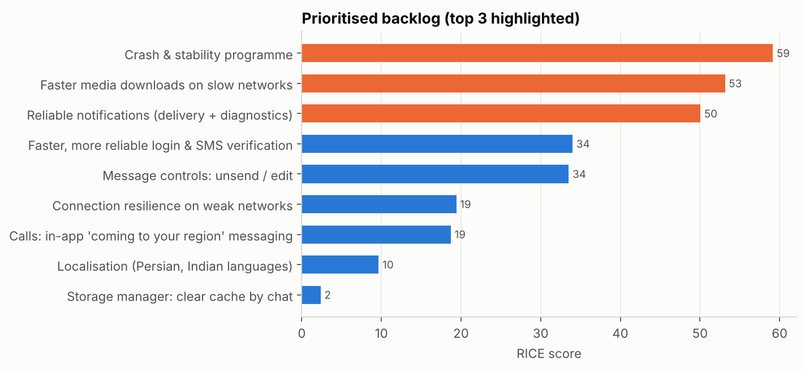

# Telegram Android: From 22,800 App Reviews to a Prioritised Roadmap

**Voice-of-customer analysis for a product team: diagnosing rating dips, measuring how users received the voice-calls launch, mining themes and feature requests, and turning them into a RICE-ranked backlog and a PRD.**

`Product analytics` · `NLP (TF-IDF, NMF topic modelling)` · `Python (pandas, scikit-learn)` · `RICE` · `PRD writing`

---

## Product question

If I were a PM on Telegram for Android in spring 2017, what should the team fix next, and how do we know?

## Data

22,816 Google Play reviews of `org.telegram.messenger` with star ratings, 10 Nov 2016 to 2 May 2017, from the public *Software Applications User Reviews* dataset (Grano et al., 2017). Average rating 4.39★; 9.3% of reviews are 1–2★.

## Approach

| Step | Method |
|---|---|
| Rating health | Weekly and daily rating trends; worst days explained with n-gram analysis of their 1–2★ reviews |
| Launch analysis | Voice calls (launched 30 Mar 2017, region by region): share of reviews, rating and request rate before vs after |
| Theme analysis | Auditable keyword taxonomy of 16 themes ([`src/themes.py`](src/themes.py)), measured by volume, average rating and share of all 1–2★ reviews |
| Validation | Unsupervised NMF topic model on 1,145 detailed negative reviews to check that the taxonomy is not missing anything |
| Feature requests | Pattern matching for explicit asks ("please add", "would be nice", "when will" …) |
| Prioritisation | RICE scoring with reach = dissatisfied reviews per quarter; effort assumptions stated openly |
| Output | PRD for the top initiative |

## Key findings



**1. The worst dip was a trust & safety incident, not a bug.** From 8 to 11 Dec 2016 the average fell to **3.57★**. Of that week's 1–2★ reviews, 66% were about an offensive religious sticker pack. **Action:** a review step for new sticker packs plus an in-app report button. This is handled outside the backlog.

**2. Voice calls landed well, but the regional rollout confused people.** After launch, call mentions doubled (5.0% → 10.4% of reviews), their average rating rose from **4.12★ to 4.33★**, and the share that were requests fell from 23% to 16%. However, **46% of post-launch 1–2★ call reviews** were from users who could not find the feature yet ("Where's that call icon!"). **Action:** in-app "coming to your region" messaging for future staged launches.

**3. The most painful recurring themes** (average rating of reviews mentioning them):

| Theme | Avg rating | Share of all 1–2★ reviews |
|---|---|---|
| Login & verification | 2.46★ | 4.2% |
| Crashes & bugs | 2.90★ | 7.2% |
| Speed & performance | 2.94★ | 3.9% |
| Notifications | 3.21★ | 5.5% |
| Media & file sharing | 3.99★ | **14.9%** (largest by volume) |



**4. Topic modelling agrees with the taxonomy.** NMF found notification, phone-number/account, calling, slow-download, update, connection and group/delete topics with no rules given. It also surfaced one under-counted need: **Persian-language support**.

## Prioritised backlog (RICE)



| Rank | Initiative | RICE |
|---|---|---|
| 1 | Crash & stability programme | 59 |
| 2 | Faster media downloads on slow networks | 53 |
| 3 | Reliable notifications (delivery + diagnostics) | 50 |
| 4 | Faster, more reliable login & SMS verification | 34 |
| 5 | Message controls: unsend / edit | 34 |

The top item is written up as a full PRD: **[`reports/PRD_app_stability.md`](reports/PRD_app_stability.md)**. It covers the problem and evidence, success metrics and guardrails, user stories, prioritised requirements (including a staged-rollout gate), the rollout plan and risks.

## Repository structure

```
├── data/download_data.py              # downloads the review dataset into data/raw/
├── notebooks/01_review_insights.ipynb
├── reports/
│   ├── PRD_app_stability.md
│   └── figures/
└── src/
    ├── themes.py                      # keyword taxonomy, request and availability patterns
    └── style.py
```

## How to run

```bash
pip install -r requirements.txt
python data/download_data.py
jupyter notebook notebooks/01_review_insights.ipynb
```

## Limitations

- Reviews are a self-selected sample: they show where pain is concentrated, not how many users are affected. In a real team I would pair them with crash analytics and support tickets.
- The keyword taxonomy is English-only. About 1% of reviews are in non-Latin scripts and are not themed.
- Effort estimates in RICE are my assumptions and would be validated with engineering.
